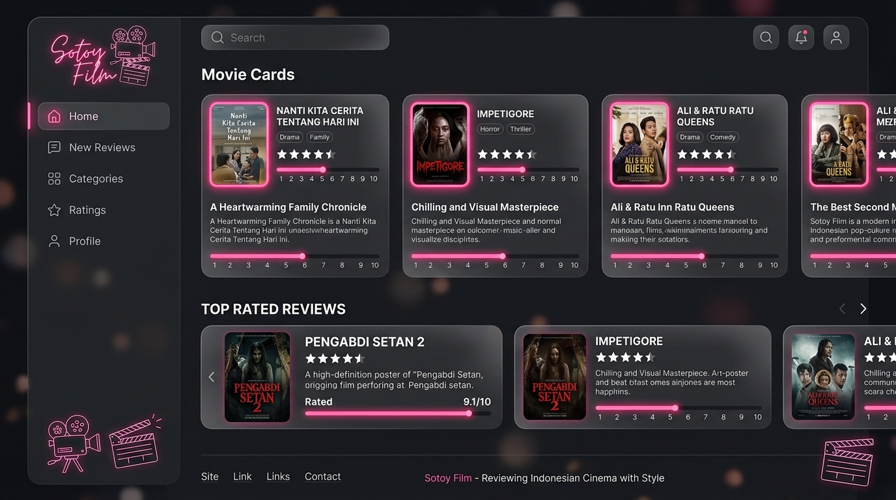
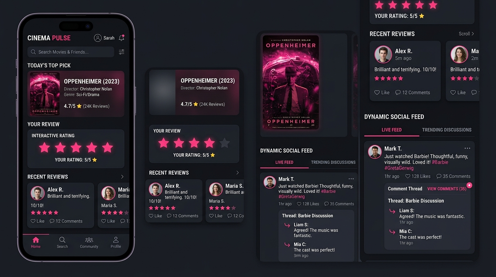
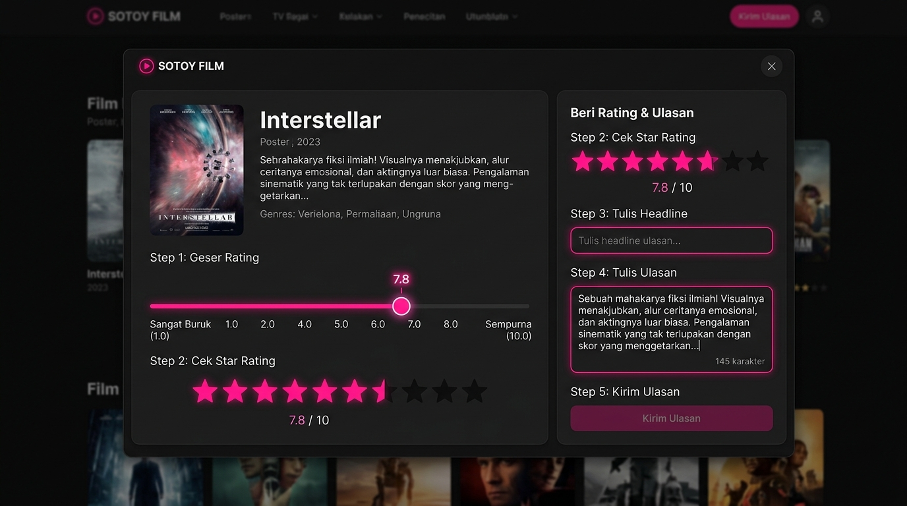
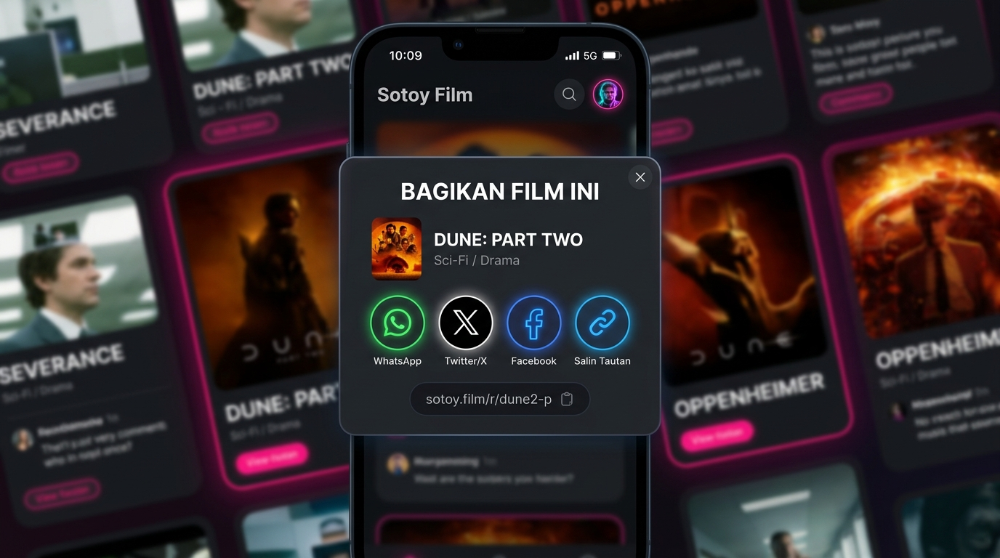

# 🎬 Sotoy Film — Platform Media Pop-Culture & Komunitas Film Indonesia

Selamat datang di **Sotoy Film**! Platform ini adalah rumah hangat bagi seluruh pencinta film, serial TV, dan animation di Indonesia. Di sini, siapa saja bisa menyalurkan opini sinematik mereka, membaca kajian mendalam, berdiskusi di forum komunitas, hingga berpartisipasi dalam menentukan rating film terdemokratis.

### 🖼️ Pratinjau Antarmuka & Panduan Lengkap
| 🌟 Tampilan Portal Panduan Utama | 💬 Forum Buzz & Rating Interaktif |
| :---: | :---: |
|  |  |
| **⭐ Panduan Rating Desimal (1.0-10.0)** | **🔗 Panduan Berbagi Konten (Share)** |
|  |  |

---

## 📑 Daftar Panduan
- [✨ Fitur Unggulan untuk Warga](#-fitur-unggulan-untuk-warga)
- [👥 Mengenal Peran Anggota (Sistem Akun)](#-mengenal-peran-anggota-sistem-akun)
- [📝 Panduan Menulis & Publikasi Artikel (Khusus Penulis & Admin)](#-panduan-menulis--publikasi-artikel-khusus-penulis--admin)
- [🎛️ Panduan Mengatur Susunan Beranda (Khusus Admin)](#️-panduan-mengatur-susunan-beranda-khusus-admin)
- [🛡️ Panduan Moderasi & Pengawasan Komunitas (Khusus Admin)](#️-panduan-moderasi--pengawasan-komunitas-khusus-admin)

---

## ✨ Fitur Unggulan untuk Warga

### 1. 🎞️ Katalog Film & Informasi Streaming Lengkap
* **Metadata Akurat:** Temukan informasi sinopsis resmi, sutradara, deretan pemeran, poster, hingga rekomendasi film serupa yang disesuaikan untuk penonton Indonesia.
* **Di Mana Menonton?** Cek langsung ketersediaan film atau serial di platform streaming legal yang beroperasi di Indonesia seperti *Netflix, Disney+ Hotstar, Prime Video, Vidio, Bioskop*, dan lainnya.

### 2. ⭐ Sistem Penilaian Ganda (Skor Sotoy)
Kami percaya opini penonton umum sama berharganya dengan ulasan kritikus. Oleh karena itu, kami menghadirkan dua metrik penilaian:
* **Skor Warga:** Rating murni dan demokratis yang dihitung secara rata-rata dari seluruh anggota komunitas terdaftar (*skala 1.0 - 10.0*).
* **Skor Kritikus Terverifikasi:** Ulasan mendalam yang ditulis oleh para kritikus terpercaya (**Si Paling Sotoy**).
* **Interaksi Ulasan:** Berikan suara setuju (*upvote*) pada ulasan yang menurut Anda bermanfaat atau menarik.

### 3. 💬 Forum Komunitas "Buzz"
Buzz adalah ruang obrolan kilat (*micro-blogging*) tempat warga berkumpul untuk berbagi pemikiran instan:
* **Bagikan Foto:** Unggah foto atau tangkapan layar film favorit Anda (sistem kami akan mengoptimalkan ukuran gambar secara otomatis agar hemat kuota).
* **Tagging Film & Artikel:** Hubungkan postingan Buzz Anda dengan film atau artikel editorial terkait agar anggota lain bisa langsung mengaksesnya.
* **Diskusi Bersarang:** Lakukan diskusi seru lewat balasan komentar bertingkat, berikan reaksi/reputasi, dan dukung iklim komunitas yang sehat.

### 4. 📰 Editorial Magazine & Kajian Sinema
Nikmati berbagai bacaan berkualitas dari tim penulis kami:
* **Ulasan Editorial & Kajian Sinema (Film Studies):** Analisis mendalam tentang makna film, sinematografi, dan teori sinema.
* **Bedah Alat Sinema (Cinema Gear):** Rekomendasi alat dan ulasan teknologi produksi film.
* **Berita Industri & Listicle:** Kabar terbaru seputar dunia perfilman lokal dan global serta rekomendasi daftar tontonan terbaik.

---

## 👥 Mengenal Peran Anggota (Sistem Akun)

Setiap anggota di Sotoy Film memiliki kontribusi unik berdasarkan peran (*role*) akun mereka:

| Lencana & Peran | Siapa Mereka? | Hak Akses Utama |
| :--- | :--- | :--- |
| **🧑 Warga Sotoy** | Anggota umum komunitas film. | Menulis ulasan film, membuat postingan Buzz, berkomentar di forum, dan memberikan voting. |
| **🏆 Si Paling Sotoy** | Kritikus film terverifikasi & kurator. | Seluruh akses Warga, ditambah ulasan mereka secara otomatis masuk ke perhitungan khusus *Skor Kritikus*. |
| **✍️ Penulis Sotoy** | Redaktur & jurnalis internal media. | Akses ke halaman CMS (sistem menulis) untuk merancang, menjadwalkan, dan mempublikasikan artikel editorial. |
| **👑 Admin Utama** | Pengelola platform & moderator tertinggi. | Akses penuh ke Panel Kontrol Admin, manajemen tata letak beranda, persetujuan kritikus, moderasi laporan, dan grafik statistik. |

---

## 📝 Panduan Menulis & Publikasi Artikel (Khusus Penulis & Admin)

Untuk Penulis dan Admin, Anda memiliki akses ke **CMS (Content Management System)** untuk memproduksi artikel berkualitas:

1. **Membuat Draft:** Masuk ke menu CMS, tulis artikel Anda dengan editor teks yang nyaman.
2. **Pengaturan SEO & Pratinjau Gambar:**
   * Tentukan *Judul SEO* dan *Meta Deskripsi* agar artikel Anda mudah ditemukan di Google.
   * Unggah gambar sampul utama (*Cover Image*) yang menarik.
   * Masukkan kata kunci target (*Keywords*) yang relevan.
3. **Status Publikasi:**
   * **Draft:** Simpan pekerjaan Anda untuk dilanjutkan nanti.
   * **Terjadwal (Scheduled):** Atur tanggal dan jam spesifik kapan artikel harus terbit secara otomatis.
   * **Published:** Publikasikan artikel secara langsung agar langsung terbaca oleh seluruh warga.

---

## 🎛️ Panduan Mengatur Susunan Beranda (Khusus Admin)

Sebagai Admin, Anda dapat mengontrol penuh apa saja yang tampil di halaman depan aplikasi melalui menu **Panel Admin > Susunan Beranda**:

### 1. Mengubah Urutan Bagian (Sections)
* **Drag & Drop:** Cukup klik dan tahan ikon titik-titik di samping baris blok, lalu geser ke atas atau ke bawah untuk menentukan posisi blok di halaman depan.
* **Tombol Cepat:** Anda juga dapat menggunakan tombol tanda panah (▲/▼) untuk memindahkan baris demi baris secara presisi.

### 2. Visibilitas Blok (Tampilkan/Sembunyikan)
* Klik ikon **Mata (👁️/👁️-off)** pada baris blok untuk menyembunyikan atau menampilkan bagian tersebut di beranda.
* *Aturan Keselamatan:* Sistem tidak mengizinkan Anda menyembunyikan semua blok. Minimal harus ada 1 blok konten yang tetap aktif agar halaman utama tidak kosong.

### 3. Mengatur Posisi Sidebar & Urutan Widget
* **Posisi Sidebar:** Pilih posisi bilah samping kanan/kiri melalui menu drop-down yang disediakan.
* **Urutan Widget:** Anda dapat mengatur urutan widget sidebar (seperti widget Buzz Terbaru, Penulis Populer, Film Populer, dsb.) dengan cara yang sama seperti memindahkan blok beranda.

### 4. Peringatan Cerdas Tata Letak (*Split-Column Warning*)
* Jika Anda menempatkan blok jenis "Lebar Penuh" (seperti banner atau galeri besar) di tengah-tengah kelompok blok "Kolom Utama" (yang memiliki sidebar), sistem akan mendeteksi ini sebagai susunan terpisah.
* Sebuah **kotak peringatan kuning** akan muncul untuk memberi tahu Anda bahwa beberapa blok akan melebar penuh secara dinamis demi kenyamanan visual pembaca. Anda dapat menyusun kembali urutannya jika ingin sidebar tetap tampil sejajar.

### 5. Keamanan Penyimpanan & Fitur Reset
* **Simpan Otomatis & Ter-Debounce:** Perubahan tata letak yang Anda buat akan disimpan secara aman ke database dengan penundaan beberapa milidetik secara otomatis (untuk mencegah beban server yang berlebihan).
* **Reset ke Default:** Jika Anda ingin mengembalikan susunan beranda seperti semula kala, klik tombol **"Reset ke Default"** dan konfirmasikan tindakan Anda pada jendela peringatan yang muncul.

---

## 🛡️ Panduan Moderasi & Pengawasan Komunitas (Khusus Admin)

Untuk menjaga ekosistem komunitas agar tetap aman, ramah, dan bebas dari spam, Admin dibekali peralatan moderasi lengkap di **Panel Admin**:

1. **Dashboard Analitik:** Pantau pertumbuhan harian pengguna aktif (*DAU*), retensi komunitas, dan demografi peran warga melalui grafik visual yang interaktif.
2. **Evaluasi Laporan Laporan Laporan:** Tinjau setiap laporan pelanggaran (ulasan kasar, komentar SARA, atau konten Buzz yang tidak relevan) yang diadukan oleh warga.
3. **Tindakan Cepat (Bulk Actions):** Tangguhkan (*suspend*) beberapa akun pelanggar aturan sekaligus, atau hapus konten bermasalah dalam satu klik.
4. **Evaluasi Banding Akun:** Pengguna yang ditangguhkan dapat mengajukan surat banding. Admin dapat membaca argumen mereka dan memutuskan untuk menerima banding (mengaktifkan kembali akun) atau menolaknya.
5. **Jejak Audit (Audit Logs):** Seluruh tindakan admin dicatat secara otomatis dalam sistem riwayat aktivitas agar pengelolaan platform tetap transparan dan akuntabel.

---

## 💡 Tips Berinteraksi untuk Warga Baru
* **Lengkapi Profil:** Unggah foto profil terbaik Anda dan tulis bio singkat tentang selera film Anda di halaman Pengaturan Profil.
* **Gunakan Filter Buzz:** Cari diskusi seru di forum Buzz menggunakan filter "Terbaru", "Terpopuler", atau cari berdasarkan tag film tertentu.
* **Patuhi Pedoman Komunitas:** Saling menghargai perbedaan opini sinematik. Gunakan fitur laporan jika Anda menemukan pelanggaran di dalam aplikasi.

Selamat bersenang-senang dan mari menjadi **Si Paling Sotoy** di komunitas film terbaik Indonesia! 🎬🍿
